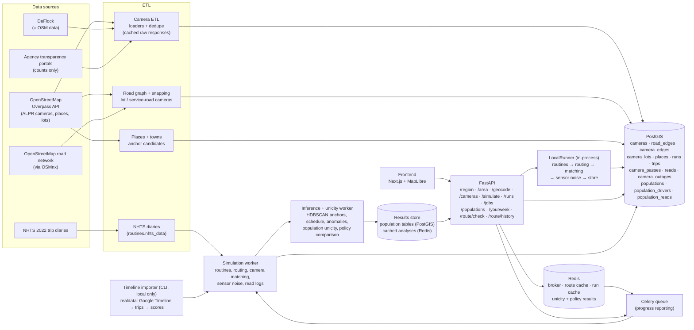

# Architecture

Plate Trail is a location-privacy check-up built on the example study's pipeline. The check-up endpoints
(`/area`, `/geocode`, `/route/check`, `/route/history`) reuse the camera loaders, snapping, routing, matcher, noise
model and inference engine below. Saved routes, saved areas and last-look snapshots stay in the browser; route checks
are compute-only and write nothing to PostGIS or Redis.

The full system from the proposal (the example study) is built. `POST /jobs/simulate` and `POST /jobs/population`
run on the Celery worker through Redis, with progress reporting and route/run caching. Unicity and policy analyses run
on request and are cached in Redis; populations are stored in PostGIS.

## What runs where

| Component | Module | Status |
|---|---|---|
| Camera ETL (Overpass loader, dedupe, direction parsing) | `backend/platetrail/etl/` | Built |
| Road graph, camera snapping, lot / service-road classification | `backend/platetrail/roads/` | Built |
| Places, home sampling, NHTS and template routine generators | `backend/platetrail/routines/` | Built |
| Routing, matcher, noise, driver simulation, runner | `backend/platetrail/sim/` | Built |
| API | `backend/platetrail/api/` | Built |
| Schema (ordered SQL migrations) | `backend/platetrail/sql/` | Built |
| Frontend | `frontend/` | Built |
| Celery app, tasks, jobs + run cache | `backend/platetrail/worker.py`, `jobs.py`, `cache.py` | Built |
| Population runs + unicity | `backend/platetrail/population.py`, `analysis/unicity.py` | Built |
| Inference engine (stays, HDBSCAN anchors, regular passes, anomalies) | `backend/platetrail/inference/engine.py` | Built |
| Policy comparison | `backend/platetrail/analysis/policies.py` | Built |
| "Your week" (session-only, nothing stored) | `backend/platetrail/yourweek.py` | Built |
| Route check for "My routes" (compute-only, nothing stored) | `backend/platetrail/routecheck.py` | Built (study region's roads) |
| Route networks for any area (roads + sensors around one route, memory only) | `backend/platetrail/routearea.py` | Built |
| Read history for a route (simulated schedule + inference, compute-only) | `backend/platetrail/routehistory.py` | Built |
| Real-data validation (Google Timeline importer, local only) | `backend/platetrail/realdata/` | Built; not yet run on a real file |

## Data flow for one simulation

1. `POST /simulate` validates the request (template, weeks, seed, match and
   noise settings).
2. The routine generator plans the driver's trips. Anchors are sampled with
   no reference to camera locations.
3. Each trip is routed (shortest free-flow time; service roads penalized for
   through traffic). Every camera on the driven edges, and every lot camera
   at the entrance used, is a *pass*. The matcher marks it captured or not
   (direction, capture convention, tolerance).
4. Sensor noise turns captured passes into reads: missed reads, look-alike
   misreads, per-camera downtime, timestamp jitter. Every read links to its
   pass.
5. The run, trips, passes, reads and outages are stored in one transaction,
   and `GET /runs/{id}` serves them back.
