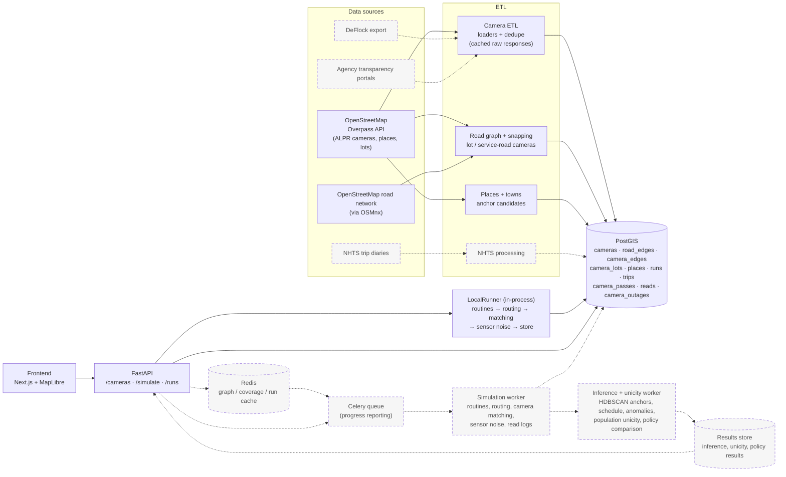

# Architecture

The full planned system from the proposal. **Solid** boxes and arrows are
built in this slice; **dashed** ones are planned. Today `POST /simulate`
runs the simulation in-process (`LocalRunner`) and writes straight to
PostGIS. The Celery queue, workers and Redis cache will slot in behind the
`SimulationRunner` interface without changing the API.

## What runs where

| Component | Module | Status |
|---|---|---|
| Camera ETL (Overpass loader, dedupe, direction parsing) | `backend/platetrail/etl/` | Built |
| Road graph, camera snapping, lot / service-road classification | `backend/platetrail/roads/` | Built |
| Places, home sampling, routine templates (NHTS stub) | `backend/platetrail/routines/` | Built (NHTS planned) |
| Routing, matcher, noise, driver simulation, runner | `backend/platetrail/sim/` | Built |
| API | `backend/platetrail/api/` | Built |
| Schema (ordered SQL migrations) | `backend/platetrail/sql/` | Built |
| Frontend | `frontend/` | In progress |
| Celery queue, Redis cache, workers, results store | — | Planned |

## Data flow for one simulation

1. `POST /simulate` validates the request (template, weeks, seed, match and
   noise settings).
2. The routine generator plans the driver's trips. Anchors are sampled with
   no reference to camera locations.
3. Each trip is routed (shortest free-flow time; service roads penalized for
   through traffic). Every camera on the driven edges, and every lot camera
   at the entrance used, is a *pass*. The matcher marks it captured or not
   (direction, capture convention, tolerance).
4. Sensor noise turns captured passes into reads: missed reads, look-alike
   misreads, per-camera downtime, timestamp jitter. Every read links to its
   pass.
5. The run, trips, passes, reads and outages are stored in one transaction,
   and `GET /runs/{id}` serves them back.
