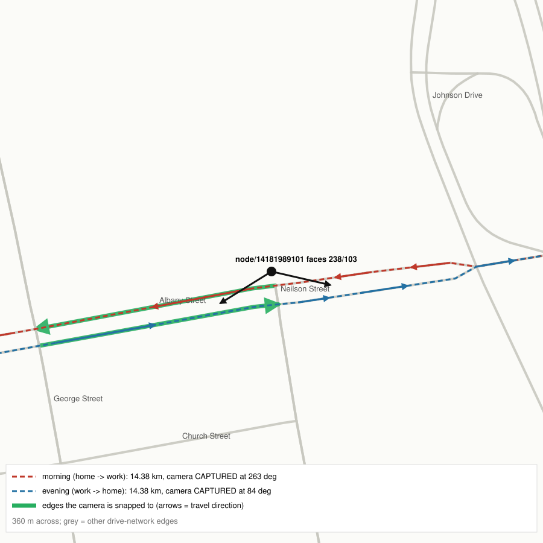

# Findings

Results recorded as the project is built, with the configuration that
produced them. All drivers are synthetic.

## F1. Coverage is sparse: one commuter's week is about 11 reads, 10 of 12 captures from one camera

**Setup.** One hand-written commuter week (`backend/scripts/demo_week.py`):
home on a residential street off Timber Oaks Rd in Edison, work at Rutgers
College Ave in New Brunswick, a commute every weekday (07:45 and 17:15), and
a Saturday trip to Menlo Park Mall. That is 12 trips and about 162 km.
Cameras: the 56 OSM ALPR cameras in Edison and New Brunswick (46 public road,
10 private lot). Matcher: `rear_plate`, 45° tolerance (`lot_entrance` see below).
Noise: defaults (all assumptions; see README).

**Result** (current model: drive + service-road graph, edge-point attachment,
divided-road snapping with facing check, `lot_entrance=access_road`; 2026-10-12).
Plate `ZZ W65HIB`.

| | Zero noise | Default noise, seed 0 | Default noise, mean of 1,000 seeds |
|---|---|---|---|
| Camera passes | 14 | 14 | 14 |
| True captures (matcher) | 12 | 12 | 12 |
| Reads after noise | 12 | 11 | 11.20 |
| Misread reads | 0 | 0 | 0.43 |
| Lost to downtime | 0 | 0 | 0.21 |
| Lost to missed reads | 0 | 1 | 0.59 |
| Distinct (state, plate) identities | 1 | 1 | 1.42 |

10 of the 12 captures come from Albany St (node 14181989101), read once in
each direction on every weekday commute. The other two come from the Saturday
mall trip: an arrival through Menlo Park Mall's Lafayette Ave entrance
(node 13271071475) and a Parsonage Rd camera (node 13874923001) on the way in.
2 passes are skipped for direction.

How this number changed as the model was fixed (same driver and trips):

| Model state | True captures |
|---|---|
| Steps 4–5 (one carriageway per camera, node-to-node routing) | 6 |
| + divided-road snapping (evening commute now sees Albany St) | 11 |
| + `ZZ` state code | 11 (plate identity change only) |
| + service roads, edge-point attachment, entrance-based lot rule | 12 |
| + opposite carriageway always snapped (`b86ddb4`) | 12 (rerun: every number in the table above unchanged) |

The "all counts identical" check after the `ZZ` change compared against the
11-capture run. The jump from 6 to 11 had come one commit earlier, from the
divided-road fix.

*Albany St is divided here. The camera faces 238° and 103° and sits 9.6 m from
the westbound carriageway (morning route, red) and 22 m from the eastbound
carriageway (evening route, blue). Green edges are the camera's snaps; before
the fix only the westbound carriageway was snapped.*

**Why it matters.**

- **Linkage and inference.** A read history built mostly from one camera
  reveals a regular crossing point and time of day, not a route. Home and work
  inference will be bounded by which cameras sit between a driver's anchors,
  so results will vary hugely from driver to driver. Report distributions
  across drivers, not a single "typical" driver.
- **Misreads matter more when reads are few.** About 4% of reads are
  misread (0.43 of 11.20 per week), but with only ~11 reads a week, a single
  misread moves about a tenth of that week's reads onto a different plate
  string. The mean of 1.42 distinct identities means roughly two weeks in
  five yield a second plate string for the same car. See the misread limitation in the
  README: this is likely an underestimate.
- **Anchor sampling must not chase cameras.** Results are very sensitive to
  whether a driver's anchors happen to sit behind a camera. Biasing anchors
  toward camera-covered lots or roads would inflate coverage and overstate
  what ALPR reveals. Step 6 samples retail and other anchors at realistic rates,
  with no reference to camera locations.
- **Density scenarios.** The proposal's fallback for sparse data (Edison's 92
  newly approved cameras as a density setting) looks necessary to show how
  conclusions change as networks grow.

**Caveats.** One hand-picked driver is an illustration, not an estimate. The
step 6 routine generator and population runs will replace it with
distributions.

## F2. Across 300 template drivers: median 6 reads a week, 10% never read

**Setup.** `backend/scripts/simulate_drivers.py --drivers 300 --weeks 1 --seed 0`
(2026-10-12, current model as in F1). Drivers come from the step 6 template
generator (183 commuters, 67 students, 50 shift workers). Homes are on
residential streets weighted by length, and anchors are sampled without
reference to cameras. Places more than 100 m from the network are excluded.
Matcher: `rear_plate`, 45° tolerance, `lot_entrance=access_road`. Noise:
defaults (assumptions).

| Template | Drivers | Trips/wk | km/wk | Camera passes | Reads after noise | Distinct cameras | Top camera's share | No reads |
|---|---|---|---|---|---|---|---|---|
Rerun on `b86ddb4` (opposite carriageway always snapped). "Top camera" is
the share of a driver's **reads** from their most-read camera, median across
drivers with at least one read.

| Template | Drivers | Trips/wk | km/wk | Camera passes | Reads after noise | Distinct cameras | Top camera (median) | No reads |
|---|---|---|---|---|---|---|---|---|
| Commuter | 183 | 18.5 | 138 | 10.5 | 7.2 | 2.1 | 70% | 11% |
| Student | 67 | 15.5 | 74 | 10.5 | 7.0 | 1.8 | 71% | 10% |
| Shift worker | 50 | 11.8 | 104 | 9.9 | 7.2 | 1.7 | 86% | 6% |

Reads per driver-week: median 6, interquartile range 3–10, max 30. 10% of
drivers are never read. **Across all drivers, the median driver gets 73% of
their reads from a single camera.**

Change from the previous run: camera passes rose slightly (commuter 10.39 →
10.54, shift worker 9.70 → 9.94), because passes on the newly snapped
opposite carriageways are recorded and then skipped for direction under
`rear_plate`. Captures, reads and the share of unread drivers are identical.
The previous "top camera's share" column (63% / 67% / 74%) was a mean over
true captures; it is now a median over reads.

**After deep-lot cameras and building outlines** (2026-10-12). The 4 cameras
deep inside lots are now road cameras on the service streets they watch, and
18 of 21 large buildings attach at their outline instead of being excluded.
Same command and seed:

| Template | Camera passes | Captures | Reads after noise | Top camera (median) | No reads |
|---|---|---|---|---|---|
| Commuter | 10.5 → 11.5 | 7.7 → 8.1 | 7.2 → 7.6 | 70% → 71% | 11% → 12% |
| Student | 10.5 → 10.5 | 7.5 → 7.6 | 7.0 → 7.1 | 71% → 75% | 10% → 9% |
| Shift worker | 9.9 → 9.4 | 7.7 → 7.3 | 7.2 → 6.9 | 86% → 88% | 6% → 4% |

Reads per driver-week: median 6 → **7**, interquartile range 3–10 → 3–10.25,
max 30 → 32; no reads 10% → 10%. **Median share of reads from one camera:
73% → 75%.** Across all 300 drivers, captures by camera kind: 2,294 public
road, 46 private lot, 21 service road (the 4 re-modelled cameras). Some
template rows shift because the place pool changed (18 places added), which
changes which anchors each seed draws. That's sampling variation, not a
model effect for that template.

**What it says.** F1 wasn't an unlucky pick. A typical driver is read about 6
times a week by about 2 cameras, and for the median driver 73% of reads come
from one camera. About one driver in ten is never read in a week. Templates
differ little, because coverage depends on where cameras sit relative to a
driver's anchors more than on how much they drive.

**Checks on the generator.**

- **Camera lots** (`scripts/check_camera_lot_share.py`, 50 seeds × 300
  drivers): 6.4% of errand trips end inside a camera-covered lot (95%
  interval 5.3–8.1%), vs 7.3% of errand places lying in one. After the
  deep-lot cameras became service-road cameras, fewer lots count as
  camera-covered: 5.3% (4.0–6.7%) vs 6.6% of places, and the realized
  category mix predicts 5.6%. Same explanation as below. Breakdown: the
  configured category mix gives 7.4%, and adding distance decay from homes
  gives 7.9%. The templates' realized mix (evening outings push food to 34%
  and leisure to 16%; leisure has no places in camera lots, retail has 18%)
  predicts 6.6%, matching the observed 6.4%. So the gap comes from the
  category mix, not a bias against camera lots, and the interval contains
  the raw share.
- **Anchor attachment**: median 10 m to the nearest edge, p90 38 m, max 95 m;
  no trip end is more than 100 m away (was 7.2% before service roads were
  added).
- **Lot-camera events** (`scripts/lot_events_by_mode.py`, 300 drivers): 110
  under `access_road` (default), 622 under `nearest`, 1,440 under `all`.
  After the deep-lot change (6 lot cameras left): 75 / 534 / 742. Raritan
  Center's remaining lot camera (12760383248) sees 40 events; the other one
  (14174561401) is now a service-road camera on Mayfield Ave.
  Raritan Center's 2 cameras see 68 events under `access_road` (all at the
  driveway camera 12760383248), vs 788 if both saw every visit. Menlo Park
  Mall: 13271071475 sees 20 and 13370492601 sees 10. 13370466401 sees none in
  this sample, but its entrance carries 2.4% of 2,000 random home-to-mall
  arrivals, so it can fire.

**Caveats.** Template parameters and noise defaults are assumptions, and
coverage depends heavily on the 56 OSM-mapped cameras. Results should be
redone with NHTS routines and with the density scenarios.

## F3. A naive home/work guess: half of drivers can't be guessed in a week, and the guess is mostly the top camera

> **Naive baseline, not the inference engine.** This measures the
> simplest thing an analyst could do with a read log. The inference engine
> (HDBSCAN anchors, schedule reconstruction, anomaly detection) is compared
> against it in F6.

**Method** (`backend/platetrail/inference/naive.py`). Using only the noisy read
log (camera + recorded time), days with at least 2 reads are used:

- **Home** = the camera that most often records a day's first or last read.
- **Work** = the camera that most often records the read just before the
  day's longest gap (the arrival before the day's main stay).
- No guess unless at least 2 days qualify. The guessed location is the
  camera's location; the error is the distance to the driver's true home and
  work (or school, for students).

**Setup.** The F2 population: `backend/scripts/naive_guess_population.py
--drivers 300 --seed 0` (2026-10-12, same drivers, matcher and default noise
as F2).

**1 week** (as F2):

| Template | Drivers | No guess | Home error median / p75 | Work error median / p75 | Home guess = top camera | Work guess = top camera | Home = work camera |
|---|---|---|---|---|---|---|---|
| Commuter | 183 | 49% | 3.7 / 8.4 km | 2.1 / 6.0 km | 80% | 71% | 72% |
| Student | 67 | 39% | 1.6 / 3.2 km | 0.9 / 1.4 km | 83% | 80% | 73% |
| Shift worker | 50 | 66% | 4.4 / 10.8 km | 1.8 / 11.0 km | 82% | 76% | 65% |
| **All** | **300** | **50%** | **2.9 / 7.8 km** | **1.5 / 5.4 km** | **81%** | **74%** | **72%** |

Errors are over drivers with a guess. Within 1 km, as a share of drivers with a guess: home 26%, work 40%. As a share of all 300 drivers: about 13% and 20% (from the rounded figures above, since half have no guess).

**4 weeks** (same drivers, longer history):

| Template | Drivers | No guess | Home error median / p75 | Work error median / p75 | Home guess = top camera | Work guess = top camera | Home = work camera |
|---|---|---|---|---|---|---|---|
| Commuter | 183 | 17% | 4.5 / 8.5 km | 3.3 / 5.9 km | 80% | 69% | 74% |
| Student | 67 | 7% | 1.2 / 2.5 km | 1.1 / 1.5 km | 81% | 77% | 76% |
| Shift worker | 50 | 28% | 4.5 / 10.0 km | 1.6 / 8.2 km | 81% | 72% | 75% |
| **All** | **300** | **17%** | **3.3 / 8.1 km** | **1.8 / 5.3 km** | **80%** | **72%** | **74%** |

Within 1 km, as a share of drivers with a guess: home 24%, work 33%. As a share of all 300 drivers: about 20% and 27% (83% have a guess). **More history makes a guess possible far
more often (no guess 50% → 17%) but doesn't make it more accurate.** The
error stays at about 3 km because the limit is where the cameras are, not
how many reads there are.

**What it says.**

- **A week of reads is often not enough to guess anything.** Half of drivers
  never have two days with two or more reads. Shift workers fare worst (66%),
  partly because their night-shift days split at midnight, which this
  baseline can't handle.
- **When a guess exists, it is mostly the driver's single most-read camera**
  (81% for home), and home and work are the same camera for 72% of guessed
  drivers. With sparse coverage (F1, F2) the read log rarely separates the
  two ends of a commute. The baseline is really answering "which camera does
  this car pass most?"
- **Work looks better than home** because workplaces and campuses cluster
  in New Brunswick near the cameras that do exist (Albany St, College Ave),
  while homes are spread across residential Edison. Demo run #8 shows this:
  both guesses are the Albany St camera, 0.18 km from work but 13.6 km from
  home.
- This sets the bar the inference engine has to beat. It also shows that
  "a camera sees you often" is not the same as "a camera reveals where you
  live". With the current camera density, an analyst gets a corridor, not an
  address, unless a camera happens to sit near the home.

**Caveats.** Template routines, noise defaults and camera positions shape
these numbers. The baseline ignores time of day beyond first/last and gap
ordering, and it can't place an anchor away from a camera.

## F4. NHTS routines vs. templates: fewer, more scattered reads; the conclusions hold

**Setup.** Same 300 drivers, seed, matcher, noise and cameras as F2/F3, with
routines from the 2022 NHTS generator (`--generator nhts`) instead of the
hand-written templates (2026-10-13). NHTS personas: 200 workers, 93
non-workers, 7 students.

| | Templates (F2/F3) | NHTS |
|---|---|---|
| Trips per week (worker / non-worker) | 18.5 commuter | 16.3 / 12.2 |
| Reads per driver-week, median (IQR) | 7 (3–10.25) | 5 (2–9.25) |
| Drivers never read | 10% | 10% |
| Share of reads from top camera, median | 75% | 60% |
| Errand trips ending in camera-covered lots (vs. 6.6% of places) | 5.3% | 7.4% |
| Naive guess: no guess possible (1 week) | 50% | 51% |
| Naive home error, median / p75 | 2.9 / 7.8 km | 3.7 / 8.8 km |
| Naive work error, median / p75 | 1.5 / 5.4 km | 2.7 / 7.4 km |
| Naive home guess = top camera | 81% | 85% |

**What it says.** Real trip diaries give drivers more varied destinations and
stay-at-home days (about 15% of worker weekdays, 35% of non-worker days). That
means slightly fewer reads, spread over more cameras. The headline findings
don't depend on the routine source: about one driver in ten is never read in
a week, half can't be placed even naively, and naive guesses are a few
kilometres off, mostly at the driver's top camera.

## F5. Unicity: two hourly sightings single out most drivers, and density barely changes that

**Setup.** Stored populations of 1,000 NHTS drivers each, seed 0 (rerun at seeds 1 and 2 for the ranges), default
matcher and noise (`python -m platetrail.population`, 2026-10-13). A point is
(camera, hour). Identity is the recorded plate. A driver is *unique* if *p*
random points from their own trace match no other recorded plate
(`analysis/unicity.py`, after de Montjoye et al. 2013). "Eligible" drivers
have at least *p* distinct points. Unicity is reported two ways: among
eligible drivers, and as a share of **all** drivers (unique × eligible). The
second is what the UI charts.

| Population | Reads per driver (median) | Never read |
|---|---|---|
| #1: 1 week, OSM cameras | 5 | 7.4% |
| #2: 4 weeks, OSM cameras | 22 | 0% |
| #3: 1 week, OSM + 92 scenario cameras | 34.5 | 0.1% |
| #4: 4 weeks, OSM + 92 scenario cameras | 141 | 0% |

**Crowd of 1,000, hourly points.** Each cell is unique among eligible / share of all drivers, seed 0, with the 3-seed range in parentheses. Eligible drivers at *p* = 4 in #1: 655 of 1,000 (650–656).

| *p* | #1 (1 wk, OSM) | #2 (4 wk, OSM) | #3 (1 wk, +92) | #4 (4 wk, +92) |
|---|---|---|---|---|
| 1 | 12% / 11% (12–15 / 11–14) | 12% / 12% (12–14 / 12–14) | 9% / 9% (9–11 / 9–11) | 9% / 9% (9–11 / 9–11) |
| 2 | 78% / 66% (78–79 / 66–68) | 84% / 84% (83–84 / 82–84) | 81% / 81% (81–85 / 81–84) | 89% / 89% (89–90 / 89–90) |
| 4 | 99.8% / 65% (99.6–99.8 / 65–65) | 99.9% / 99% (99.9–99.9 / 98–99) | 99% / 98% (99.2–99.5 / 97.9–98.1) | 99.9% / 99.9% (99.9–100 / 99.9–100) |
| 8 | 100% / 35% (100 / 30–35) | 100% / 91% (100 / 89–91) | 99.9% / 97% (99.9–100 / 96–97) | 100% / 100% (100 / 100) |

**Crowd size** (#1, *p* = 2, unique among eligible): 97% in a crowd of 100
(3 seeds: 96–99%), 78% in 1,000. **Time resolution** (#1, *p* = 2, share of all drivers): 66% at
hourly points, 81% at 15-minute points.

**What it says.**

- **Two sightings are almost enough; four always are.** If plates were hashed
  or pseudonymized, knowing that a car passed two cameras in two particular
  hours singles out about 80% of drivers in a crowd of 1,000. Four sightings
  single out essentially everyone who has four.
- **With sparse cameras the limit is having enough reads, not being
  distinguishable.** In one week on the OSM network only 65% of drivers
  even have 4 points, which is why the all-drivers share drops at high *p* in
  population #1. Four weeks of retention (#2) or the 92 extra cameras (#3)
  remove that limit: almost every driver has 8+ points and is unique.
- **Unicity falls as the crowd grows** (97% → 78% from 100 to 1,000 cars),
  and Edison PD's portal reports 518,797 "unique plate reads" in 30 days.
  Simulated shares are therefore **upper bounds** for the real crowd. The
  *p* = 4 result is so close to 100% that it is unlikely to drop much.

**Caveats.** Random points from the trace are a generous model of what an
adversary knows. Real side information (a known commute time) is less
random and may be more or less identifying. Misreads split a car into
fragments, which this measure counts as non-matching.

## F6. The inference engine places home no better than the naive baseline, needs the 92 cameras to be accurate, and its confidence is about consistency

**Setup.** `backend/scripts/evaluate_inference.py --drivers 300 --weeks 4`
(NHTS, seed 0, default noise; 2026-10-13), with and without the 92 scenario
cameras, rerun at seeds 1 and 2 for the ranges in parentheses. Each driver's
reads under their true plate go to both methods. Errors are against the true
home and work (or school) anchors. The matched-driver comparison and both
versions of the 1 km share come from a copy of the script that also saves
per-driver errors; the published numbers it shares with the script are
identical.

| | OSM cameras | OSM + 92 scenario |
|---|---|---|
| Reads per driver (median, 4 weeks) | 21 (19–21) | 138 (117–138) |
| **Home, matched drivers** (those the baseline places): n | 271 (261–271) | 300 (300) |
| Home, matched: engine / naive median error | **4.02 / 4.48 km** (3.75–4.02 / 4.36–4.63) | **1.00 / 1.02 km** (0.99–1.01 / 1.02–1.11) |
| Home, matched: engine closer / farther / same spot | 91 / 88 / 92 | 142 / 134 / 24 |
| Home, matched: median per-driver difference; sign test | 0 km at all seeds; p = 0.88 (0.20–0.88) | 0 km at all seeds; p = 0.67 (0.06–0.67) |
| Home: engine, no estimate / median / p75 error, every driver it places (secondary) | <1% / 4.21 / 7.57 km (median 3.84–4.21) | 0% / 1.00 / 1.88 km |
| Home: naive, no estimate / median / p75 | 10% / 4.48 / 8.62 km | 0% / 1.02 / 2.13 km |
| Home within 1 km, share of drivers with an estimate: engine / naive | 17% / 18% (15–17% / 15–18%) | 50% / 49% (49–50% / 45–49%) |
| Home within 1 km, share of all 300 drivers: engine / naive | 17% / 16% (15–17% / 13–16%) | 50% / 49% (49–50% / 45–49%) |
| **Work** (drivers with a work/school anchor): engine, no estimate / median | 56% / 5.54 km (55–58% / 5.43–6.17) | 5% / 1.21 km (4–5% / 1.00–1.40) |
| Work: naive, no estimate / median | 9% / 3.50 km (9–12% / 3.49–3.75) | 0% / 1.11 km (0% / 0.89–1.11) |
| Routines recovered | 302 of 327 (92%; 92–95%) | 640 of 654 (98%; 98% at all seeds) |
| Anomalies: precision / recall | 57% / 29% (57–63% / 29–30%) | 50% / 36% (50–55% / 36–40%) |
| Engine home error by confidence: high / medium / low | 3.60 (n=239) / 5.35 (46) / 5.09 km (14); high 3.55–3.75 | 0.95 (283) / 1.38 km (17) / —; high 0.95–1.00 |

A *routine* is a trip the driver repeats between the same two places at a
similar time (within 45 minutes) on at least 3 days. It is *observable* if any
of its trips produced a read, and *recovered* if at least half of its trips
produced a read matching a regular pass the engine inferred (same camera,
within 45 minutes). `inference/engine.py`: `routine_trips`,
`schedule_recovery`.

**What it says.**

- **The engine almost always produces a home estimate, and on the OSM
  network it is about 4 km off.** On the 271 drivers both methods place, its
  median error is 4.02 km against the baseline's 4.48 km. Per driver,
  though, it is closer for 91, farther for 88 and at the same spot for 92:
  the median difference is 0 km and a sign test finds no difference
  (p = 0.88; 0.20–0.88 across seeds). The gap between the two medians is not
  a per-driver improvement. Both methods are bounded by where the cameras
  are: the nearest camera to a typical home is kilometres away, and stay
  evidence can only point at cameras.
- **With the 92 extra cameras, half of drivers' homes are placed within
  1 km** by either method: 50% (engine) and 49% (baseline), the same as a
  share of drivers with an estimate or of all drivers, because every driver
  gets one. Work is placed within about 1.2 km. Density, not
  cleverness, decides what a read log reveals.
- **Schedules are what the cameras reveal best.** 302 of the 327 observable
  routines (92%; 92–95% across seeds) are recovered on the OSM network, and
  98% with the extra cameras. "This car
  passes Albany St at about 8:10 on weekdays" is the strongest conclusion the
  data supports.
- **Work detection is the engine's weak point on sparse cameras.** It needs a
  weekday gap of 3–12 h bracketed by reads, and with few cameras 56% of
  workers never have one. The naive "camera before the longest gap" rule
  answers more often, and is closer when it does (3.5 km vs. 5.5 km).
- **Confidence measures consistency, not closeness.** On the OSM network a
  "high" confidence home is still 3.6 km off at the median. The same camera
  can appear night after night while sitting far from the home. The UI says
  so next to every estimate.
- **Anomaly detection is a rough signal.** About half the flagged reads
  belong to genuine one-off trips, and about a third of observable one-off
  trips are flagged.

## F7. Policy comparison: short search windows and aggregation work; rounding to the hour barely helps

**Setup.** `GET /populations/{id}/policies` (`backend/scripts/policy_report.py`,
2026-10-13) on populations #1–#4 from F5. Each policy transforms the read log
an analyst could query, then the same measurements run on what remains
(`analysis/policies.py`: `compare`, `_metrics`). Values are seed 0; parentheses
give the range over seeds 0, 1 and 2, from a clean rebuild that reproduced
every seed-0 value exactly. "Reads queryable" is seed 0.

"Home ≤ 1 km" is reported two ways: **of estimated** is the share of drivers
with an engine home estimate whose estimate is within 1 km; **of all drivers**
is the same count over all 1,000 drivers. When a policy leaves few estimates
(for example the ±12 h window, about 3% of drivers on today's network), the
first share rests on a few dozen drivers and swings widely between seeds.
Unicity is the share of all drivers singled out by 2 or 4 hourly points.

**Population #2 (4 weeks, OSM cameras).**

| Policy | Reads queryable | Engine home estimated | Home ≤ 1 km, of estimated | Home ≤ 1 km, of all drivers | Engine work estimated | Unique, p = 2 | Unique, p = 4 |
|---|---|---|---|---|---|---|---|
| No limits (4 weeks kept) | 26,402 | 99% | 17% (16%–17%) | 17% (16%–17%) | 45% (41%–45%) | 84% (82%–84%) | 99% (98%–99%) |
| Keep 14 days | 13,196 | 94% | 17% (16%–18%) | 16% (15%–17%) | 33% (28%–33%) | 78% (78%–80%) | 89% (87%–89%) |
| Keep 7 days | 6,640 | 78% (76%–78%) | 19% (17%–21%) | 15% (13%–16%) | 26% (21%–26%) | 67% (66%–68%) | 66% (63%–66%) |
| Keep 1 day | 785 | 0% | — | 0% | 0% | 15% (13%–15%) | 4% (3%–4%) |
| Round timestamps to the hour (unicity at 15-min points: 97% (96%–97%) → 84% (83%–84%)) | 26,402 | 99% | 17% (15%–18%) | 16% (15%–17%) | 47% (43%–47%) | 84% (83%–84%) | 99% (98%–99%) |
| Search window ±36 h around an incident | 2,788 | 43% (42%–43%) | 22% (18%–24%) | 9% (8%–10%) | 16% (12%–16%) | 56% (56%–58%) | 30% (27%–30%) |
| Search window ±12 h | 940 | 3% (3%–4%) | 38% (17%–38%) | 1% (0%–1%) | 7% (5%–7%) | 24% (22%–24%) | 6% (4%–6%) |
| Aggregate counts only | 0 | 0% | — | 0% | 0% | 0% | 0% |

**Population #3 (1 week, OSM + 92 cameras).**

| Policy | Reads queryable | Engine home estimated | Home ≤ 1 km, of estimated | Home ≤ 1 km, of all drivers | Engine work estimated | Unique, p = 2 | Unique, p = 4 |
|---|---|---|---|---|---|---|---|
| No limits (1 week) | 37,778 | 99% (98%–99%) | 43% (43%–46%) | 43% (42%–46%) | 75% (71%–75%) | 81% (81%–84%) | 98% |
| Keep 1 day | 4,470 | 0% | — | 0% | 0% | 32% (32%–39%) | 40% (39%–40%) |
| Round to the hour (15-min unicity: 93% (93%–95%) → 81% (81%–85%)) | 37,778 | 99% (98%–99%) | 42% (42%–47%) | 42% (41%–46%) | 77% (72%–77%) | 81% (81%–85%) | 98% |
| Search window ±36 h | 14,842 | 72% (69%–72%) | 36% (36%–38%) | 26% (25%–27%) | 50% (46%–50%) | 76% (76%–79%) | 86% (82%–86%) |
| Search window ±12 h | 5,118 | 12% (10%–12%) | 33% (31%–37%) | 4% (3%–5%) | 21% (19%–21%) | 55% (55%–56%) | 50% (46%–50%) |
| Aggregate counts only | 0 | 0% | — | 0% | 0% | 0% | 0% |

**Population #4 (4 weeks, OSM + 92 cameras)**, the densest and longest case:

| Policy | Reads queryable | Engine home estimated | Home ≤ 1 km, of estimated | Home ≤ 1 km, of all drivers | Engine work estimated | Unique, p = 2 | Unique, p = 4 |
|---|---|---|---|---|---|---|---|
| No limits (4 weeks) | 150,828 | 100% | 47% (46%–53%) | 47% (46%–53%) | 94% (92%–94%) | 89% (89%–90%) | 100% |
| Keep 14 days | 75,259 | 100% | 45% (43%–50%) | 44% (43%–50%) | 86% (83%–86%) | 85% (85%–88%) | 100% |
| Keep 7 days | 37,884 | 98% | 40% (38%–47%) | 39% (37%–46%) | 75% (72%–75%) | 81% (81%–84%) | 98% (98%–99%) |
| Keep 1 day | 4,612 | 0% | — | 0% | 0% | 32% (32%–38%) | 39% (38%–40%) |
| Round to the hour (15-min unicity: 98% → 88% (88%–90%)) | 150,828 | 100% | 47% (46%–53%) | 47% (46%–53%) | 96% (94%–96%) | 88% (88%–90%) | 100% |
| Search window ±36 h | 15,907 | 75% (75%–77%) | 37% (35%–40%) | 28% (27%–30%) | 49% (46%–51%) | 85% (85%–88%) | 86% |
| Search window ±12 h | 5,438 | 11% (10%–11%) | 37% (31%–37%) | 4% (3%–4%) | 22% (19%–22%) | 62% (62%–63%) | 49% (44%–51%) |
| Aggregate counts only | 0 | 0% | — | 0% | 0% | 0% | 0% |

On the dense network, 7-day retention still leaves 98% of drivers unique at
p = 4 and 75% with a work estimate. Retention limits only bite when they are
very short.

Population #1 (1 week, OSM) follows the same pattern: no limits
76% (76%–78%) home estimated and 66% (66%–68%) unique at p = 2;
±12 h window 3% (3%–5%) and 22% (20%–24%); 1-day retention
0% and 14% (13%–14%) (`data/exports/policy_pop1.txt`).

**What it says.**

- **Retention matters in proportion to how much history it removes.** Going
  from 4 weeks to 7 days cuts work estimates from 45% to 26% (3 seeds:
  21–26%) and *p* = 4 unicity from 99% to 66% (63–66%). Home placement stays poor throughout, because on
  this network it was camera-limited to begin with. A 1-day limit removes
  almost everything.
- **Rounding timestamps to the hour changes almost nothing** for inference,
  and only reduces unicity measured at a finer resolution than the rounding
  (97% → 84% at 15-minute points). It cannot reduce hourly unicity at all.
  As a privacy measure it is mostly cosmetic.
- **Limited search windows are the strongest lever short of aggregation.** A
  ±12 h window around an incident leaves a few hours of reads per car: home
  is estimable for 3% of drivers (3–4%), 1% of all drivers' homes are placed
  within 1 km, and two-point unicity falls to 24% (22–24%; 4 weeks, OSM).
  With the denser network the same window still leaves 55% unique (55–56%;
  1 week), so
  windows must shrink as camera networks grow.
- **Aggregate-only release removes per-vehicle inference entirely**, at the
  cost of every per-vehicle investigative use.
- **Density outweighs most policies.** One week of the denser network (#3)
  reveals more than four weeks of the current one (#2): 43% vs. 17% of homes
  within 1 km, whether counted over drivers with an estimate or over all
  drivers (both 43% vs. 17%).

**Caveats.** Retention beyond the simulated period (up to 4 weeks here) equals
"no limits", so the proposal's 3-year retention is not simulated directly.
Longer histories can only add evidence, so the 4-week row is a lower bound
for long retention. The search-window incident time is random per driver,
which favours no particular part of the week.

## F8. Robustness: the conclusions survive every matching and noise assumption

**Setup.** `backend/scripts/sensitivity.py --drivers 300 --weeks 1` (NHTS,
seed 0; 2026-10-13). The same 300 routines are rerun with one assumption
changed at a time from the defaults ([assumptions.md](assumptions.md)).
"Home ≤ 1 km" is given two ways: of drivers with an engine home estimate, and of all 300 drivers. "Unique, p = 2" is a share of all drivers. The two 1 km columns come from a copy of the script that also prints the estimate count; every other column is identical to the script's output. Unicity is
measured in this crowd of 300.

| Assumption changed | Reads per driver (median) | Never read | Engine home error (median, drivers with an estimate) | Homes estimated (of 300) | Home ≤ 1 km, of estimated | Home ≤ 1 km, of all drivers | Unique, p = 2 |
|---|---|---|---|---|---|---|---|
| Defaults | 5 | 10% | 3.99 km | 215 | 17.7% | 13% | 74% |
| Tolerance 30° (from 45°) | 3 | 15% | 3.71 km | 180 | 21.1% | 13% | 60% |
| Tolerance 60° | 5 | 10% | 3.99 km | 215 | 18.1% | 13% | 74% |
| Capture oncoming (from rear plate) | 4 | 14% | 3.70 km | 199 | 21.6% | 14% | 69% |
| Undirected cameras capture nothing | 5 | 10% | 3.99 km | 215 | 17.7% | 13% | 74% |
| Ambiguous direction: alternate tag | 5 | 10% | 3.89 km | 215 | 17.7% | 13% | 74% |
| Lot events: every camera at the lot | 5 | 8% | 3.84 km | 224 | 17.9% | 13% | 76% |
| No noise | 5 | 9% | 3.94 km | 220 | 18.2% | 13% | 73% |
| Miss rate 15% (from 5%) | 4 | 10% | 4.22 km | 209 | 16.7% | 12% | 74% |
| Misreads ×3 | 5 | 10% | 3.99 km | 213 | 17.8% | 13% | 74% |
| Downtime ×4 | 5 | 10% | 3.94 km | 212 | 17.5% | 12% | 73% |
| **+92 scenario cameras** | **33** | **0%** | **1.14 km** | **293** | **44.7%** | **44%** | **91%** |

**What it says.**

- **No single modelling assumption changes the picture.** Across all of them,
  home error stays at 3.7–4.2 km, and 12–14% of all drivers' homes fall
  within 1 km (16.7–21.6% of the drivers with an estimate).
  The largest effect is a strict 30° tolerance, which loses captures on
  curved roads (median reads 5 → 3) and lowers two-point unicity from 74% to
  60%.
- **Some assumptions don't bind on this network.** All 56 OSM cameras have a
  direction tag, so the undirected-camera assumption has no effect. Only one
  lot camera has conflicting tags. Widening the tolerance to 60° adds
  nothing, because cameras snap to roads that already align with their
  facing.
- **Noise is second-order.** Turning noise off or tripling misreads moves
  nothing measurable at this sample size. Misreads leave the read count
  unchanged, and the engine ignores reads under other plates.
- **Camera density dominates.** The 92 scenario cameras multiply reads by
  six, place 44% of all drivers' homes within 1 km (44.7% of the 293 with an
  estimate), and raise two-point unicity to 91%.

**Caveats.** One week and 300 drivers, so differences of a percentage point or
two are within sampling noise. Free-flow routing and the NHTS-derived
behaviour are not varied here (see [assumptions.md](assumptions.md)).
